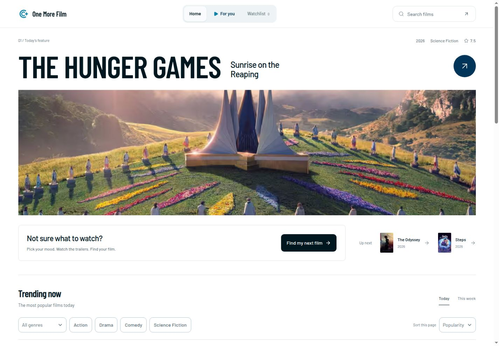

# One More Film

Find a film for tonight. Browse trends, explore the people behind a movie, or choose your preferences and discover your next watch through a scrolling trailer feed.

**[Try the live app](https://one-more-film-ruby.vercel.app)** · [Media kit](https://one-more-film-ruby.vercel.app/media-kit)



Built with **Next.js App Router, React, TypeScript, Tailwind CSS and shadcn/ui (Base UI)**. Movie data comes from TMDB.

## Features

- Daily and weekly trends, search and pagination, with genre and sort filters saved in the URL
- Movie details, trailers, full cast, production facts and related films
- Dedicated cast and crew profiles with expandable biographies and scrollable filmographies
- English-language discovery by genre, era and runtime, presented as a trailer feed with native YouTube controls
- Browser-local watchlists, synchronized between tabs without an account
- Responsive layouts, light/dark/system themes, keyboard controls and shared-artwork transitions that respect reduced motion

## Run locally

Requires **Node.js 22 or later** and npm.

1. Install dependencies and create the local configuration:

   ```sh
   npm ci
   cp .env.example .env.local
   ```

2. For live data, add your **API Read Access Token** from [TMDB settings](https://www.themoviedb.org/settings/api) to `.env.local`:

   ```dotenv
   TMDB_READ_ACCESS_TOKEN=your_read_access_token
   TMDB_DEMO_MODE=false
   ```

   To explore without a token, leave it empty and keep `TMDB_DEMO_MODE=true` for the labeled sample catalogue. A failing live API never silently switches to demo data.

3. Start the app:

   ```sh
   npm run dev
   ```

   Open [localhost:3000](http://localhost:3000). The token stays on the server; never prefix it with `NEXT_PUBLIC_` or commit `.env.local`.

## Architecture and tradeoffs

The code is organized by feature:

```text
app/           Server pages, routes and API handlers
components/    Discovery, movies, people, watchlists, themes and shared UI
lib/           TMDB client, validation and pure helpers
tests/        Behavior tests using the Node test runner
public/        SVG identity and media kit assets
```

- **No database:** TMDB provides movie data, localStorage holds watchlists, and React context keeps the active discovery session. Saved films stay on this browser; they do not sync across devices.
- **Server-owned data access:** one TMDB client handles credentials, validation, eight-second timeouts, five-minute caching and safe errors. React `cache` deduplicates detail lookups between metadata and page rendering.
- **Load what is needed:** the trailer feed loads after preference submission and prepares the next player. Responsive images, priority hero artwork, self-hosted fonts and intent-based route prefetching keep initial work focused.
- **Bounded discovery:** validated preferences filter TMDB suggestions; this is not an AI recommendation model. Pagination removes duplicates and limits retries. YouTube controls playback and availability, so preparing a trailer cannot guarantee buffering or autoplay.
- **Recoverable failures:** explicit loading, empty, not-found and upstream-error states; saved movie data is validated before use.

See [discovery rules and limits](docs/discovery.md) for the exact matching, pagination and playback behavior.

## Verification

```sh
npm run check   # Prettier, ESLint, TypeScript and tests
npm run build   # production build with Turbopack
```

GitHub Actions runs these checks on pushes to `main` and on pull requests, using demo data without a TMDB secret. Tests cover API authentication and failures, input validation, discovery constraints, pagination and cancellation, catalogue filters, link safety and damaged watchlist storage.

See the [development reference](docs/maintenance.md) for Lighthouse commands, deployment, themes and media-kit regeneration.

## Credits

Movie data and artwork: [TMDB](https://www.themoviedb.org). This product uses the TMDB API but is not endorsed or certified by TMDB.

Design refinement used [Unslop](https://github.com/heydamir/unslop) by Damir Sokolovsky ([@heydamir](https://x.com/heydamir)), licensed CC BY 4.0. The logo is an editable SVG.
